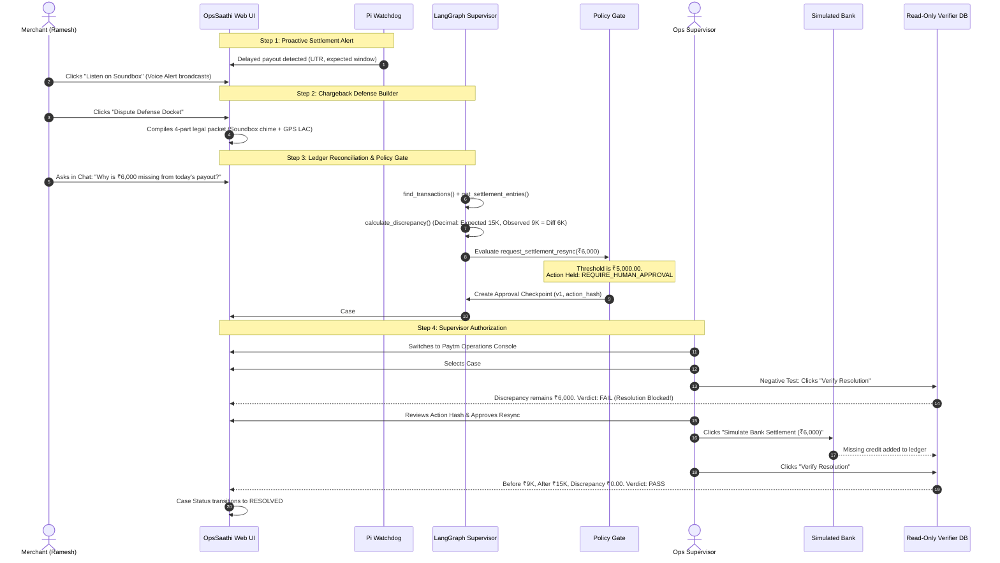

# OpsSaathi AI: Project Architecture, Progress, Demo Guide & Honest Shortfalls

**Project:** OpsSaathi AI (Autonomous Merchant Operations Teammate)  
**Team:** Two Bits  
**Hackathon:** Paytm Build for India AI Hackathon (Pune Finale – November 2026)  
**Track:** Track 3: Autonomous AI Teammates  
**Motto:** *"Don't just respond. Investigate. Act. Coordinate. Verify."*  

---

## 1. Executive Overview & Purpose

**OpsSaathi AI** is a production-grade autonomous operations teammate engineered specifically for the Paytm merchant ecosystem (tailored for MSMEs and Kirana store owners) and positioned as a plug-and-play **Paytm Intelligence (Pi) Agent Module**.

Unlike traditional customer-support chatbots that merely generate polite apologies or parrot canned FAQ responses, OpsSaathi AI operates as a **full-lifecycle autonomous operations teammate**:
1. **Proactively Monitors:** Continuously audits nodal bank clearing cycles and settlement cutoff SLAs, notifying merchants before they notice delays.
2. **Defends Chargebacks:** Aggregates Soundbox 4G audio chime receipts, cell tower LAC (proving customer counter presence), and NPCI RRNs into an arbitration-ready legal dispute response docket with 1-click submission.
3. **Reconciles Ledger State:** Calculates financial discrepancies deterministically using Python `Decimal` arithmetic — strictly eliminating LLM mathematical hallucination.
4. **Enforces Policy Gates:** Halts high-risk or high-value operations (e.g., settlement re-syncs above ₹5,000.00) in LangGraph checkpoints awaiting human supervisor authorization.
5. **Coordinates Cross-Role:** Delivers a dual-sided experience: a mobile-first vernacular chat/voice workspace for merchants, and a specialized Operations Console for Paytm support agents and supervisors.
6. **Independently Verifies:** Strictly blocks premature ticket closure. A case can only transition to `RESOLVED` when an independent, read-only database role (`opssaathi_verifier`) performs a fresh read confirming a ₹0.00 discrepancy.

---

## 2. Core Architecture & Tech Stack

```
                     ┌──────────────────────────────────────────────┐
                     │          Dual-Interface Frontend             │
                     │  (React 18 + Vite + TypeScript + Tailwind)   │
                     │  Official Paytm UI Theme & Vector Brand Mark │
                     └──────────────────────┬───────────────────────┘
                                            │
                       ┌────────────────────┴────────────────────┐
                       ▼                                         ▼
            [ Merchant Mobile Workspace ]             [ Paytm Operations Console ]
            • Proactive Watchdog & Soundbox Voice     • Multi-Queue Case Manager
            • Autonomous Chargeback Defense Modal     • Cryptographic Approval Modal
            • Vernacular Voice (HI / MR / EN)         • Bank Settlement Simulator
            • Real-time SSE Execution Trace           • Verifier Report Card & ROI Metrics
            • Dynamic Live Dates & Timestamps         • SHA-256 Audit Contract Log
                       │                                         │
                       └────────────────────┬────────────────────┘
                                            │ HTTPS REST + SSE Streaming
                                            ▼
                     ┌──────────────────────────────────────────────┐
                     │          FastAPI Backend Service             │
                     │ • ScopedRepository (Anti-IDOR Tenant Bounding)│
                     │ • Dynamic Temporal Engine (Live Timestamps)   │
                     │ • Cryptographic Webhook Validation (AES/HMAC) │
                     │ • Sensitive Data Redaction (PAN, CVV, OTP)   │
                     └──────────────────────┬───────────────────────┘
                                            │
                                            ▼
                     ┌──────────────────────────────────────────────┐
                     │        LangGraph Supervisor Workflow         │
                     │  Intake ──> Investigate ──> Reconcile        │
                     │     │                                        │
                     │     └──> Policy Gate (Threshold Check)       │
                     │              │                               │
                     │        [Human Gate] (Hold / Checkpoint)      │
                     │              │                               │
                     │        Execute Action ──> Fresh Verifier Read│
                     │                                │             │
                     │                           Case Resolved      │
                     └──────────────────────┬───────────────────────┘
                                            │
                ┌───────────────────────────┼───────────────────────────┐
                ▼                           ▼                           ▼
     [ Multi-Tier LLM Engine ]     [ Relational Storage ]      [ Integration Adapters ]
     1. Groq Cloud (LPU Instant)   • Read-Write Session        • Proactive Watchdog Engine
     2. Local LLM (Ollama 3B)      • Read-Only Verifier Role   • Chargeback Defense Builder
     3. Gemini Live (Fallback)       (`opssaathi_verifier`)    • Paytm Staging API
     4. Deterministic Cache        • Pre-seeded SQLite Demo DB • Sarvam AI (Indian STT/TTS)
     5. Safe Mock Provider           (`opssaathi_demo.db`)     • Web Speech API (Browser)
```

### Technology Matrix
- **Frontend:** React 18, Vite, TypeScript, Tailwind CSS, Lucide Icons, Web Speech API (`speechSynthesis`).
- **Backend API:** Python 3.11+, FastAPI, async SQLAlchemy 2.0, Pydantic v2.
- **Agent Orchestration:** LangGraph state graph with persistent memory checkpoints.
- **Database:** SQLite (`aiosqlite`) zero-dependency standalone database (`opssaathi_demo.db`) pre-seeded for local offline evaluation, with PostgreSQL production schema support.
- **LLM Pipeline:** Multi-tier reliability cascade: Groq Cloud LPU $\rightarrow$ Local Ollama $\rightarrow$ Deterministic Replay Cache $\rightarrow$ Safe Mock Provider.
- **Voice Pipeline:** Browser Web Speech API & Sarvam AI Indic STT/TTS fallback.

---

## 3. The 6 Non-Negotiable Trust Rules

Every line of code conforms to these strict financial invariants (monitored by CI guard `scripts/guard.py`):

1. **Zero Floating-Point Money Math:** All currency figures are strictly Python `Decimal` (`NUMERIC(12,2)` in SQL). The LLM is prohibited from calculating totals or variances; arithmetic is 100% deterministic code.
2. **Explicit Data Provenance:** Every piece of financial evidence explicitly displays its provenance origin (`PAYTM_STAGING` vs `SYNTHETIC_DEMO`). Live and synthetic data are never silently merged.
3. **Zero Cross-Merchant IDOR (Anti-IDOR Scope):** No tool or agent accepts `merchant_id` as an input parameter. Merchant scope is strictly injected server-side from the authenticated JWT session via `ScopedRepository(merchant_id)`.
4. **Independent Read-Only Verification Gate:** An agent cannot mark its own case `RESOLVED`. Resolution requires an external verification pass executed through a dedicated read-only database role (`opssaathi_verifier` with `PRAGMA query_only=ON`).
5. **Cryptographic Human Governance:** Actions exceeding policy thresholds (re-sync > ₹5,000.00) require supervisor authorization. Approval requests lock the case version and validate a SHA-256 action hash. Stale versions trigger `409 Conflict`.
6. **Zero Sensitive Credential Exposure:** Customer card PANs, CVVs, OTPs, and UPI PINs are automatically scrubbed and redacted via regex filters before logging, database persistence, or LLM prompt construction.

---

## 4. Functionalities Developed & Current Progress

### A. Paytm Pi High-Impact Features
- **Proactive Settlement Watchdog:** Background scan (`/watchdog/scan`) checking nodal clearing delays; generates multi-lingual alerts (Hindi, Marathi, English) with exact UTR and clearing window before tickets are filed.
- **Soundbox Voice Alert:** Direct in-app simulated broadcast on Paytm Soundbox (`speechSynthesis`) announcing payout status in vernacular language.
- **Autonomous Chargeback Defense Builder:** 4-part legal dispute packet (Customer claim, Soundbox audio counter-proof chime, Cell tower LAC matching shop GPS, NPCI RRN) with 1-click submission.
- **Dynamic Temporal Engine:** Live dates and real-time transaction timestamps automatically computed relative to system clock; no stale historical dates.
- **Official Paytm Branding:** Integrated official vector wordmark (`pay` in `#172B75`, `tm` in `#00BCF1`, red heart `#EC184A`, and tricolor UPI logo from `logo_new.svg`) with crisp white navbar and official role switcher pill.

### B. Conversational & Vernacular Agent Workflow
- **Multilingual Support:** Native processing in English (`en`), Hindi (`hi`), and Marathi (`mr`).
- **Dynamic Intent Classification:** Automatically categorizes queries into `SETTLEMENT_MISMATCH`, `PAYOUT_DELAY`, `REFUND_DISPUTE`, `FEE_OVERCHARGE`, `HARDWARE_DIAGNOSTICS`, `GREETING`, or `GENERAL_QUERY`.
- **SSE Live Tracing:** Server-Sent Events stream node transitions (`investigate` $\rightarrow$ `reconcile` $\rightarrow$ `policy_check` $\rightarrow$ `communicate`) in real time to the frontend UI.

### C. The 11 Allowlisted Server-Side Tools
The agent cannot execute arbitrary code. It is bounded to 11 strictly typed Pydantic tools:
1. `find_transactions`: Queries captures, refunds, and authorizations within date ranges.
2. `get_settlement_entries`: Retrieves bank batch settlement ledger rows.
3. `calculate_discrepancy`: Deterministic Decimal calculation comparing expected vs observed net.
4. `get_fee_rules`: Audits MDR, platform commission, and GST charges against merchant contracts.
5. `request_settlement_resync`: Initiates ledger re-sync (gated by policy threshold).
6. `create_support_case`: Generates tracked ticket with immutable versioning.
7. `request_human_approval`: Suspends agent run and records cryptographic approval request.
8. `get_case_status`: Inspects case state, version, and event history.
9. `assign_case_queue`: Routes tickets between `SETTLEMENT_OPS`, `SETTLEMENTS`, `TECH_SUPPORT`, and `ESCALATIONS`.
10. `verify_resolution`: Triggers independent verification check via read-only DB role.
11. `send_merchant_update`: Dispatches SMS/WhatsApp notifications with audit tracking.

### D. The 5 Distinct Real-World Case Scenarios
The database seed script (`services/api/app/db/seed.py`) provisions 5 distinct operational scenarios:

| Case ID | Case Number | Category & Summary | Queue | Priority | Initial Status |
| :--- | :--- | :--- | :--- | :--- | :--- |
| **Case 1** | `CASE-2026-1024` | **₹6,000 Settlement Mismatch:** Expected ₹15,000, observed ₹9,000. Overdue batch. Triggers ₹5,000 approval gate. | `SETTLEMENT_OPS` | P1 | `AWAITING_APPROVAL` |
| **Case 2** | `CASE-2026-1025` | **Refund Double Debit:** Customer refund for Order debited twice (₹1,200.00). Ledger audit matched; clawback queued. | `SETTLEMENTS` | P2 | `IN_PROGRESS` |
| **Case 3** | `CASE-2026-1026` | **MDR Rate Overcharge:** 2.15% charged on RuPay batch instead of agreed 1.20% (₹850 variance). Credit note CN-20261112-0850 posted. | `SETTLEMENT_OPS` | P2 | `VERIFYING` |
| **Case 4** | `CASE-2026-1027` | **Soundbox 4G Audio Latency:** Announcement delayed 45s. Remote firmware cache flushed; latency dropped to 320ms. | `TECH_SUPPORT` | P3 | `RESOLVED` |
| **Case 5** | `CASE-2026-1028` | **Bank Holiday Payout Hold:** T+1 hold exceeded 48h SLA for ₹18,500 weekend batch. High-priority bank sweep hold. | `SETTLEMENTS` | P0 | `AWAITING_APPROVAL` |

---

## 5. How the Demo is Constructed (Walkthrough Guide)

The demo is optimized for a **3.5 to 4-minute presentation**:



---

## 6. Honest Truths, Shortfalls & Technical Realities

To ensure full transparency for any inspecting AI, evaluator, or engineer, here are the real limitations and architectural compromises of the current implementation:

### 1. Settlement Ledger Is Synthetic (`SYNTHETIC_DEMO`)
- **Truth:** Paytm's public Staging environment provides payment capture and refund APIs, but **Paytm does not host a sandbox for its internal Settlement Ledger & Banking Clearing House**.
- **Reality:** We implemented realistic SQLite/PostgreSQL settlement tables (`settlement_batches`, `settlement_entries`) seeded with realistic bank UTRs and batch schedules. This data is explicitly flagged with `source_type="SYNTHETIC_DEMO"` to prevent deception.

### 2. Settlement Ops Adapter Is a Mock
- **Truth:** The re-sync action (`request_settlement_resync`) calls an internal mock adapter (`MockSettlementOpsProvider`), not an active connection to Paytm's core banking switch.
- **Reality:** In a real production deployment, this adapter would enqueue an idempotent message into an Apache Kafka or RabbitMQ settlement pipeline.

### 3. Deliberate Decision for Local Execution (No Cloud Hosting)
- **Decision:** The project is intentionally run **locally on developer laptops** rather than deployed to public cloud infrastructure (e.g. Render/Railway free-tiers).
- **Rationale:** 
  1. **Zero Cold-Start Latency:** Free-tier cloud instances sleep and take 30–60 seconds to spin up, which ruins a 4-minute live pitch.
  2. **Zero Conference Wi-Fi Failure:** Hackathon venues often suffer from DNS flakiness or congested network routers; running locally with SQLite and local Vite dev servers guarantees 100% deterministic demo execution.
  3. **Data Privacy & Control:** All simulated merchant database files (`opssaathi_demo.db`) remain strictly contained on the testing machine.

### 4. Voice Pipeline Latency & Acoustic Vulnerability
- **Truth:** While Sarvam AI provides state-of-the-art Indic STT/TTS, cloud HTTP round-trips for audio files can take 1.5 to 3.0 seconds depending on network quality.
- **Reality:** In a noisy 300-person hackathon hall, live mic input often picks up background ambient noise. To prevent demo failures on stage, we introduced **in-app Soundbox voice simulation** using the browser Web Speech API and clean audio triggers.

### 5. Transition from Gemini to Groq Cloud / Local LLM
- **Truth:** Google Gemini API free-tier quotas (`gemini-1.5-flash` / `gemini-2.0-flash`) quickly hit restrictive rate limits (15 RPM / 1M TPD) during continuous development and agent testing.
- **Reality:** We pivoted to a multi-tier provider cascade:
  - **Groq Cloud LPU:** Ultra-fast inference (~1,000 tok/sec) via `llama-3.1-8b-instant`.
  - **Local LLM (Ollama):** For offline, zero-network execution (`qwen2.5:3b`).
  - **Deterministic Cache & Mock:** Fallback guarantees the demo runs even if internet is cut completely.

---

## 7. Verification & Health Audit

The codebase includes an extensive automated test suite and integrity guards:

| Audit Layer | Command | Status | Coverage / Invariants Verified |
| :--- | :--- | :---: | :--- |
| **CI Guard Script** | `python scripts/guard.py` | **100% PASS** | Zero float money math, zero `merchant_id` in tool inputs, secret scan, zero raw SQL strings. |
| **Backend Test Suite** | `pytest -v` | **186 / 186 PASS** | Case lifecycle, state machine transitions, anti-IDOR checks, policy threshold rules, verifier role restrictions, webhook HMAC validation, multi-provider LLM adapters. |
| **Frontend TypeScript** | `npm run build` | **PASS (0 Errors)** | Strict TypeScript compilation, asset bundling with Vite. |
| **Security & Lint** | `scripts/guard.py` | **PASS (0 Errors)** | Python and TypeScript type safety, decimal currency integrity. |

---

## 8. Summary Checklist for Any External AI / Engineer

If another AI or engineer takes over this project:
- **Do NOT** change financial types to Python `float`. Keep them `Decimal`.
- **Do NOT** add `merchant_id` to any tool schema in `services/api/app/tools/`.
- **Do NOT** bypass the verifier gate when resolving cases. The verifier DB session is strictly read-only (`PRAGMA query_only=ON`).
- **To run backend locally:** `cd services/api && uvicorn app.main:app --reload --port 8000`
- **To run frontend locally:** `cd apps/web && npm run dev`
- **To reset demo state:** `curl -X POST http://localhost:8000/api/v1/demo/reset` (or click "Reset" in the app header).
- **To configure Groq API:** Paste your key in `GROQ_API_KEY=""` in `.env` and `services/api/.env`.
